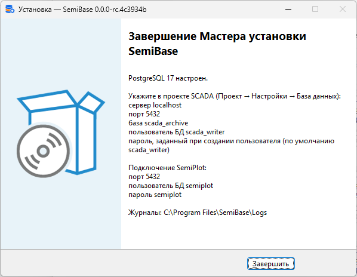
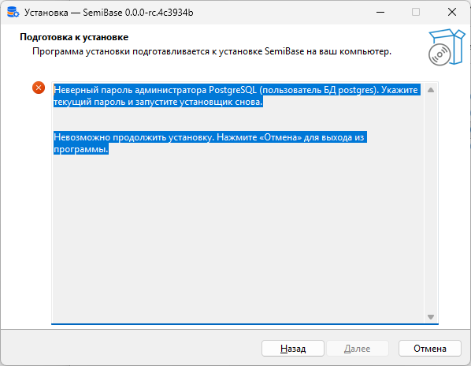

# SemiBase


[](https://coveralls.io/github/Semiteq/SemiBase?branch=master)


<div align="center">
    
</div>

SemiBase настраивает на одном компьютере с Windows базу scada_archive в PostgreSQL 17: Simple-Scada 2
записывает в эту базу архив, [SemiPlot](https://github.com/Semiteq/SemiPlot) читает архив из неё.
Установщик `SemiBase-Setup.exe` устанавливает PostgreSQL 17, если на компьютере нет ни одной
службы PostgreSQL, создаёт базу, пользователей БД и таблицы и проверяет, что SemiPlot читает
архив.

SemiBase не делает резервных копий архива и не входит в состав SCADA. PostgreSQL принимает
подключения только с этого компьютера, поэтому SCADA и SemiPlot работают на этом же компьютере.

## Требования

- Windows x64 и права администратора.
- Simple-Scada 2 с архивом в PostgreSQL.
- На компьютере установлена одна служба PostgreSQL 17 или нет ни одной службы PostgreSQL.
  Службы PostgreSQL других версий рядом со службой PostgreSQL 17 установщик не использует и не
  меняет. Администратор PostgreSQL 17 — пользователь БД postgres.

Установщик `SemiBase-Setup.exe` находится на странице
[Releases](https://github.com/Semiteq/SemiBase/releases/latest) и при установке ничего не скачивает.

## Установка

Запустите установщик до того, как проект SCADA начнёт записывать архив: базу scada_archive и
пользователя БД scada_writer для SCADA создаёт установщик.

1. Если SCADA уже записывает архив в PostgreSQL 17, остановите проект SCADA. При первой настройке
   сервера установщик перезапускает службу PostgreSQL, и подключения SCADA прерываются.
2. Запустите `SemiBase-Setup.exe`.
3. На странице «Пароли пользователей БД» укажите пароли (раздел [Пароли](#пароли)).
4. После установки укажите значения с последней страницы в проекте SCADA
   (Проект → Настройки → База данных) и в подключении SemiPlot.

<div align="center">
    
</div>

### Установка из PowerShell

Выполните команды в PowerShell от имени администратора. Команда `Read-Host` запрашивает пароль и
не сохраняет его в истории команд. Если переменная не задана, установщик использует пароль по
умолчанию.

```powershell
$env:SEMIBASE_SUPER_PASSWORD = [Net.NetworkCredential]::new('', (Read-Host 'Пароль администратора PostgreSQL (postgres)' -AsSecureString)).Password
$env:SEMIBASE_WRITER_PASSWORD = [Net.NetworkCredential]::new('', (Read-Host 'Пароль пользователя БД scada_writer' -AsSecureString)).Password
$setup = Start-Process -FilePath .\SemiBase-Setup.exe -ArgumentList '/VERYSILENT', '/SUPPRESSMSGBOXES', '/NORESTART', '/LANG=russian' -Wait -PassThru
$setup.ExitCode
```

| Код    | Значение                                                                                 |
| ------ | ---------------------------------------------------------------------------------------- |
| `0`    | PostgreSQL 17 настроен, проверки завершились без ошибок                                  |
| `7`    | Установка невозможна. Причина и действие записаны в последней строке последнего журнала `setup-*.log` |
| другой | Установщик завершился с ошибкой, PostgreSQL 17 не настроен                               |

Журналы находятся в папке `C:\Program Files\SemiBase\Logs`. Значения для SCADA и SemiPlot те же,
что на снимке выше. Порт указан в последней строке журнала `site-*.log`:
`Done: site completed against localhost:5432/scada_archive.`

## Пароли

| Пользователь БД | Назначение               | Пароль по умолчанию | Переменная                 | Когда установщик задаёт пароль                    |
| --------------- | ------------------------ | ------------------- | -------------------------- | ------------------------------------------------- |
| `postgres`      | Администратор PostgreSQL | `postgres`          | `SEMIBASE_SUPER_PASSWORD`  | Только при установке PostgreSQL 17 этим установщиком |
| `scada_writer`  | SCADA записывает архив и метки рецептов | `scada_writer`      | `SEMIBASE_WRITER_PASSWORD` | Только при создании пользователя БД               |
| `semiplot`      | SemiPlot читает архив    | `semiplot`          | нет                        | При каждом запуске                                |

Чтобы сменить пароль пользователя БД scada_writer, выполните команду psql. Команда запрашивает
пароль администратора PostgreSQL (пользователь БД postgres), затем новый пароль дважды. Для пароля
администратора замените последнее слово команды на `postgres`. Если PostgreSQL 17 установлен не
этим установщиком, укажите в команде папку и порт этого PostgreSQL.

```powershell
& 'C:\Program Files\PostgreSQL\17\bin\psql.exe' -h localhost -p 5432 -U postgres -d postgres -c '\password scada_writer'
```

- После смены пароля администратора указывайте новый пароль при каждом запуске установщика: в поле
  страницы паролей или в переменной `SEMIBASE_SUPER_PASSWORD`.
- После смены пароля scada_writer сразу укажите тот же пароль в проекте SCADA
  (Проект → Настройки → База данных). Новые подключения с прежним паролем PostgreSQL отклоняет.
- Пароль пользователя БД semiplot не меняйте: каждый запуск установщика снова задаёт пароль
  `semiplot`.

## Если установка невозможна

Установщик показывает причину и действие на экране, а при установке из PowerShell записывает их в
последнюю строку журнала `setup-*.log`. В строке перед ней записаны подробности, например имя
программы, которая занимает порт 5432. Ниже описаны случаи, в которых действия с экрана
недостаточно.

<div align="center">
    
</div>

### Найдено несколько служб PostgreSQL 17

Установщик настраивает одну службу PostgreSQL 17. Чтобы найти службу, к которой подключается
SCADA, сравните порт каждой службы с портом в проекте SCADA (Проект → Настройки → База данных).
Выполните команды в PowerShell от имени администратора. Папка данных службы указана после `-D` в
`PathName`. Если в `PathName` есть `-o "-p <порт>"`, служба работает на этом порту. Иначе порт
указан в последней строке `port` файлов `postgresql.conf` и `postgresql.auto.conf` папки данных,
а без такой строки порт 5432.

```powershell
Get-CimInstance Win32_Service | Where-Object PathName -like '*pg_ctl*' | Format-List Name, State, PathName
Select-String -Path '<папка данных>\postgresql.conf', '<папка данных>\postgresql.auto.conf' -Pattern '^\s*port\s*='
```

Остальные службы остановите и удалите командами из сообщения установщика. Команда `sc.exe delete`
удаляет только службу: папка данных с архивом остаётся на диске.

### Не удалось прочитать настройки службы PostgreSQL

Если архив на этом сервере нужен, не удаляйте PostgreSQL. После имени службы сообщение называет
файл и номер строки с ошибкой, например
`C:\Program Files\PostgreSQL\17\data\postgresql.conf line 12: syntax error`, или ошибку самой
службы. Исправьте эту строку или ошибку и запустите установщик снова.

### Служба PostgreSQL осталась остановленной

Если установщик сообщил «Утилита semibase.exe завершилась с ошибкой» и служба PostgreSQL не
запущена, откройте журнал `site-*.log` из этого сообщения и найдите в его последних строках
фрагмент из таблицы. Если служба называется иначе, замените
`postgresql-x64-17` в командах.

| Фрагмент журнала `site-*.log` | Что делать |
| --- | --- |
| `will stay stopped` | Дождитесь, пока `Get-Service postgresql-x64-17` покажет `Stopped`, и выполните `Start-Service postgresql-x64-17` |
| `site sends no Start` | Дождитесь, пока `Test-NetConnection localhost -Port 5432` покажет `TcpTestSucceeded : False`, и выполните `Start-Service postgresql-x64-17` |
| `starting service` | Выполните `Start-Service postgresql-x64-17` |
| `stopped again after the Start, and nothing answers` или `stopped again after the Start, and checking` | Сервер завершился при запуске. Найдите причину в журналах сервера в папке `log` папки данных и в журнале событий Windows «Приложение». Если причина в параметре из файла `postgresql.auto.conf` папки данных (например, `shared_buffers`), удалите строку этого параметра и выполните `Start-Service postgresql-x64-17`. Повторный запуск установщика записывает строку снова, поэтому сначала устраните причину |
| `stopped again after the Start, but the server answers` | Сервер работает без службы. Когда сервер начнёт принимать подключения, выполните `& '<папка PostgreSQL>\bin\pg_ctl.exe' stop -D '<папка данных>'`, затем `Start-Service postgresql-x64-17` |
| `did not reach running within` | Дождитесь, пока `Get-Service postgresql-x64-17` покажет `Running` или `Stopped`. При `Stopped` выполните действия строки `nothing answers` |
| `after the Stop; check it with Get-Service`, или работу установщика прервали | Если `Get-Service postgresql-x64-17` показывает `Stopped`, выполните `Start-Service postgresql-x64-17` |

## Удаление

Удалите SemiBase через «Программы и компоненты». Программа удаления удаляет утилиту
`semibase.exe` и оставляет PostgreSQL 17 с архивом и журналы в папке
`C:\Program Files\SemiBase\Logs`.
